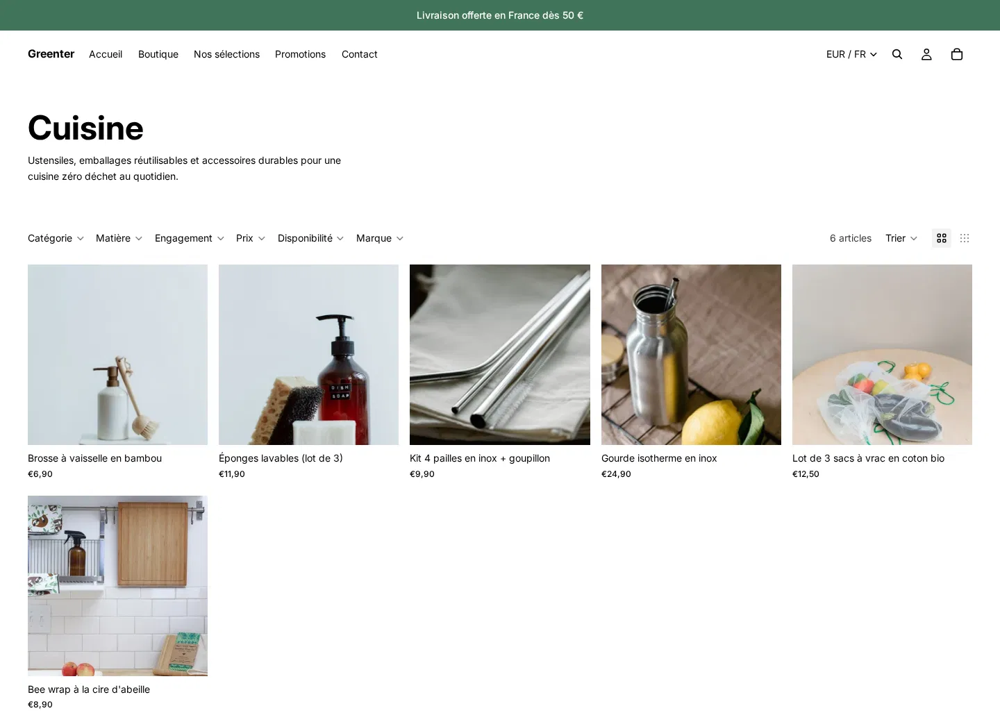
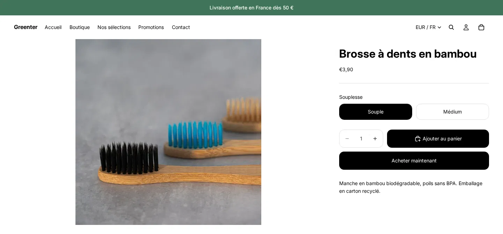
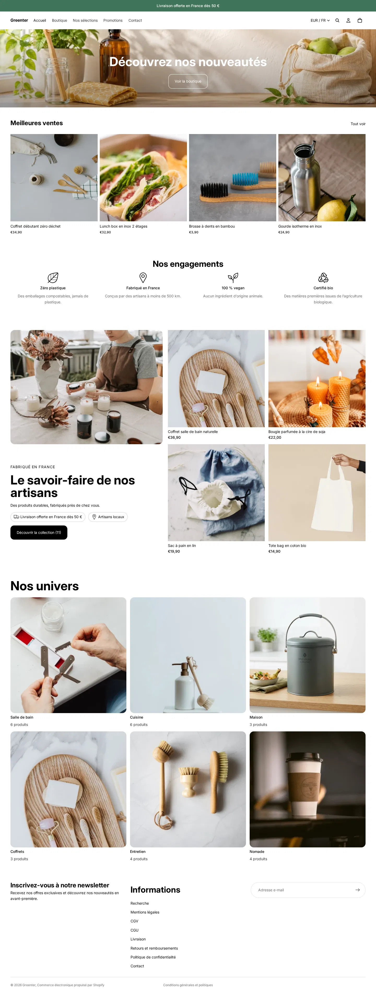
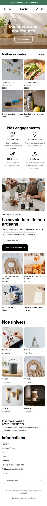
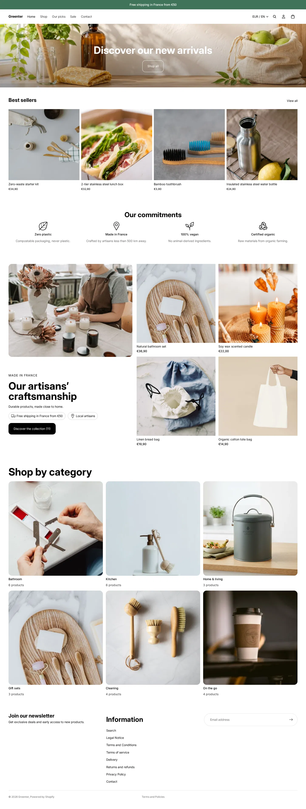

# Greenter — Shopify store for the French eco market (demo)

A demo Shopify store for an eco-friendly products brand targeting France. It covers the full setup: a customized Horizon theme with custom Liquid sections, a catalog imported from CSV, collections and filters, shipping and payments for France and nearby markets, SEO, legal pages, and an end-to-end checkout QA pass. The storefront is French by default, with a full English version under `/en/`.

**Live demo:** https://greenter-demo.myshopify.com (development store, password on request)

## Screenshots

**Collection page with filters**



**Product page**



**Full-page previews** (click to open full size)

| Home — FR (desktop) | Home — mobile | Home — EN (desktop) |
|---|---|---|
| <a href="docs/screenshots/01-home-fr.png"></a> | <a href="docs/screenshots/04-home-mobile.png"></a> | <a href="docs/screenshots/05-home-en.png"></a> |

## What's implemented

| Requirement | What I did |
|---|---|
| Theme customization / Liquid | Theme `greenter-theme` based on Shopify Horizon (Online Store 2.0). Custom sections: `eco-engagements` (brand commitments with icon/text blocks), `eco-made-in-france` (banner with badge blocks and a linked collection), `eco-univers` (collection grid with per-tile blocks). All text goes through `` settings and `locales/*.json`, with no hardcoded strings. Mobile-first CSS on Horizon breakpoints. One square image ratio across product gallery, product cards, collection cards, cart and mega-menu. |
| Product import | 26 products (32 rows including variants) imported via CSV. Prices in EUR including VAT, with compare-at prices for sale items. |
| Categories & filters | 12 collections: 6 by product type, 5 thematic collections built from tag rules, and a Sale collection. Search & Discovery filters: Catégorie, Matière, Engagement, Prix, Disponibilité, Marque, built on the `custom.matiere` and `custom.engagement` metafields. |
| i18n | French as the default language plus English (`/en/`). Products, variants, collections, menus, policies and image alt texts are translated, and English URL handles are set. |
| Shipping | Market **France**: Colissimo 4,90 € (free from 50 €), Point relais 3,50 €. Market **Europe proche** (BE / LU / CH): 9,90 € (free from 80 €). |
| Payments | Test gateway covering the success, decline and gateway-error scenarios. |
| SEO | SEO title and description in FR and EN for products and collections. Canonical URLs, `hreflang` fr / en / x-default, Open Graph tags, JSON-LD structured data and sitemap. |
| Legal (France) | Mentions légales, CGV, CGU, livraison, retours, confidentialité, all linked from the footer on every page. |

## QA

### Checkout scenarios

| Scenario | Expected result |
|---|---|
| France, cart < 50 € | Colissimo 4,90 € and Point relais 3,50 € offered |
| France, cart ≥ 50 € | Free shipping offered |
| Belgium, cart < 80 € | Europe proche rate 9,90 € |
| Belgium, cart ≥ 80 € | Free shipping offered |
| Test card `1` | Payment succeeds, order created |
| Test card `2` | Payment declined, clear error message |
| Test card `3` | Gateway error handled, no order created |
| Fulfill + tracking number | Order fulfilled, shipping confirmation with tracking sent |
| Refund + restock | Refund issued, inventory restored |
| Checkout in English (`/en/`) | All labels, rates and products shown in English |
| Mobile | Full flow works, no layout breaks, tap targets usable |

### Bugs found & fixed

- A separate shipping rate for oversized products broke checkout shipping for mixed carts. Fixed by reworking the shipping profile setup.
- Shipping rate names were not translated in the English checkout.
- The footer had no links to the legal pages.
- English alt texts, URL handles and policies were missing.
- Automatic translation turned the variant value "Médium" into "Psychic". Variant options were corrected by hand.
- Product images used mixed aspect ratios (Auto / Portrait). The theme now uses a single square ratio.

## Theme structure

```
layout/     page wrappers (theme.liquid, password.liquid)
sections/   page sections, including the custom eco-* sections
snippets/   reusable Liquid partials rendered with 
blocks/     theme blocks used inside sections
locales/    storefront and theme-editor translations (fr, en, …)
templates/  JSON templates that define which sections each page uses
config/     global theme settings schema and saved values
assets/     CSS, JavaScript, icons and static images
```

## Local development

Requires [Shopify CLI](https://shopify.dev/docs/api/shopify-cli).

```bash
# Local preview with hot reload (http://127.0.0.1:9292)
shopify theme dev --store greenter-demo

# Pull the current live theme (e.g. after changes in the theme editor)
shopify theme pull --store greenter-demo --live

# Push local changes to a theme
shopify theme push --store greenter-demo

# Lint Liquid and theme files
shopify theme check
```

## Stack

Shopify, Liquid, HTML, CSS, JavaScript, Shopify CLI, Admin GraphQL API.
